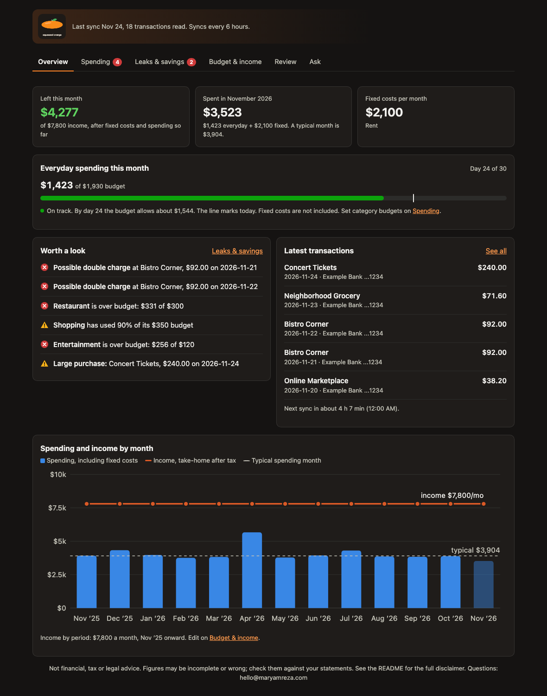

# Squeezed Orange

AI automates your budget, spots money leaks, and suggests savings without accessing your bank account; example question it answers: Suggest ways to save $500 a month. Which expenses were outliers? Was I charged twice? Can I spend $300 this weekend? Which charges repeat every month?

It reads only the alert emails that get automatically forwarded to a dedicated inbox (read-only Gmail) and any CSV you upload.

## Requirements

- Claude Code 2.1.275 or later, and the Claude desktop app (the dashboard is a Claude artifact, and the 6-hourly sync runs only while the app is open)
- Python 3.9 or later
- A dedicated Gmail inbox and a Google Cloud project (Gmail API, read-only access)
- Purchase alerts turned on at each bank or card, sent to that inbox
- Developed and tested on macOS; other systems are untested

*Illustrative screenshot with made-up data.*

<!-- eval-score:start -->
**Tested:** 35 of 35 automated checks passing on 2026-11-25, plus 3 of 3 model-graded eval cases on 2026-11-25. Details are in `evals/`.
<!-- eval-score:end -->

## One-time manual setup (required, about 30 minutes for 5 bank or card accounts)

Squeezed Orange never logs in to your bank, so you connect it once yourself. After that it runs on its own.

| Step | What you do |
|---|---|
| 1. Finance inbox | Create a dedicated Gmail address for bank and card alerts. |
| 2. Bank alerts | In each bank or card app, turn on purchase alerts (and a daily or low balance alert) and send them to that inbox, directly or by forwarding. |
| 3. Google access | Create a Google Cloud project, enable the Gmail API and make a read-only OAuth client. `/finance-setup` walks you through it; you never paste secrets into chat. |
| 4. Install and authorize | Run `/finance-setup`, approve read-only access once in your browser. |
| 4b. Alert formats | `/finance-setup` has you paste one example alert per bank (private details removed) and writes the matching `banks.json` entry. |
| 5. Delivery check (manual) | After setup, use each of your cards and accounts for your next purchases and watch your finance inbox to confirm an alert arrives for each one. If an account goes a month with no alerts, check its alert and forwarding settings. This cannot be tested automatically because it depends on your bank. |
| 6. Optional backfill | Download a CSV from each bank or card website and upload it on the Spending tab to load past months. |
| 7. Optional: install as an app | In Claude Desktop (6.28899.0 or later, Mac or Windows), open your dashboard and choose **Install as app** from the Share or title menu. This is a beta and may not be available on every account. |

Until step 6 or a few months of alerts, answers that need merchant history say "not enough history yet".

## Coming back: where to look

| I want to | Do this |
|---|---|
| See what is set up and the one next step | Run `/finance-status` in Claude |
| Resume setup | Run `/finance-setup` again; it skips finished steps |
| See what is left on the dashboard | The **Getting started** card on Overview (hide it when done) |
| Sync now | Tell Claude "Sync my finances now" |
| Rename the dashboard | Budget & income tab, "Your dashboard" |

| Piece | Path |
|---|---|
| Manifest | `.claude-plugin/marketplace.json` (root); `plugins/squeezed-orange/.claude-plugin/plugin.json` |
| Sync skill | `plugins/squeezed-orange/skills/finance-sync/SKILL.md` |
| Commands | `/finance-setup`, `/finance-status` in `plugins/squeezed-orange/commands/` |
| Scripts | `plugins/squeezed-orange/scripts/` (gmail_sync, parse_transactions, run_checks, examples for `banks.json` and `history.json`) |
| Dashboard | `plugins/squeezed-orange/dashboard/template.html` |
| Automated checks | `plugins/squeezed-orange/tests/` (run `python3 plugins/squeezed-orange/scripts/run_checks.py`) |
| Model-graded evals | `plugins/squeezed-orange/evals/` (run `claude plugin eval .` in the plugin folder) |

Status: pre-release. Fill the author and license fields in both manifests before publishing.

Install: `/plugin install squeezed-orange --marketplace BuildwithMaryam/squeezed-orange-ai-budgeting`

Sync: every 6 hours while the Claude desktop app is open. The dashboard shows when the next sync is due. To sync sooner, tell Claude "Sync my finances now".

## Disclaimer

Squeezed Orange is provided for general information and personal organization only. It is not financial, investment, tax, accounting or legal advice, and it is not a substitute for a licensed professional. Figures, categories, alerts, budgets, projections and AI-generated answers may be incomplete or wrong, including because of missed or misread emails, wrong categorization, double counting or model error. Check anything important against your bank and card statements before you rely on it.

The software is provided "as is", without warranty of any kind, express or implied, including fitness for a particular purpose, accuracy, availability and non-infringement. To the fullest extent permitted by law, MarBeh Tech LLC, its owners, and contributors are not liable for any loss, damage, missed payment, fee, penalty, tax consequence, data loss or security incident, or any indirect, incidental or consequential damages, arising from the use of, or inability to use, this software. You use it at your own risk and are responsible for your financial decisions.

You are responsible for your own accounts and credentials: the Google Cloud project, the OAuth client file, the access token stored on your computer, and the dedicated finance inbox. Keep them private and revoke access when you stop using the plugin. The plugin reads mail with read-only Gmail access, stores its working data on your computer and in your own dashboard, and relies on third-party services (Google, Anthropic and your banks) whose terms and availability are outside our control. We are not affiliated with, endorsed by, or sponsored by any bank, card issuer, Google or Anthropic.

This notice is not legal advice, and the terms above are subject to applicable law. See the LICENSE file for the software license.

## License and contact

Copyright (c) 2026 MarBeh Tech LLC. MIT License (see `LICENSE`). Author: Maryam Reza.

Questions and issues: hello@maryamreza.com
